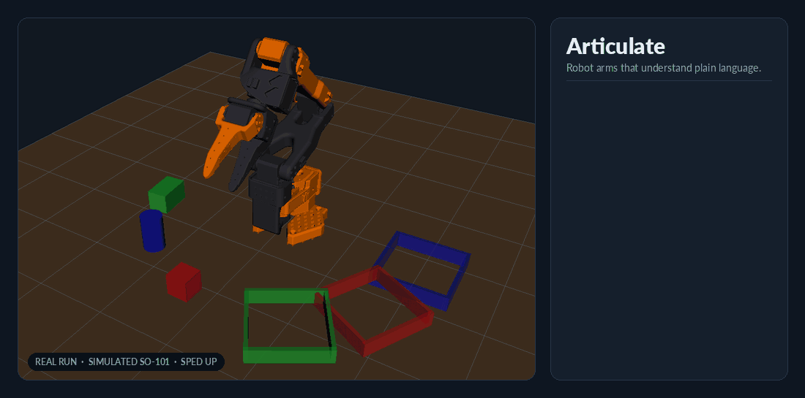
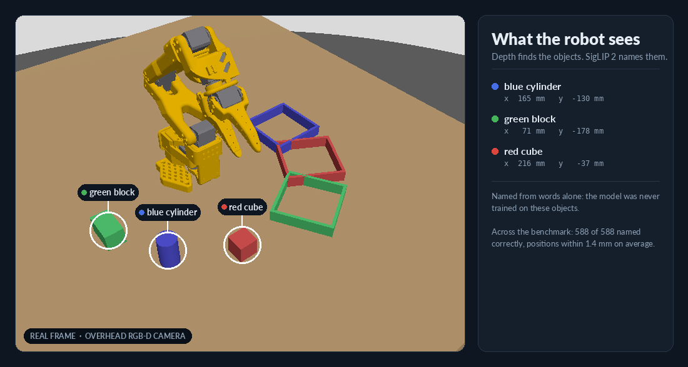

# Articulate

**Robot arms that understand plain language.**

[](https://github.com/StrawhatXYZ/articulate/actions/workflows/ci.yml)
[](LICENSE)



<sub>A real run in the simulation, sped up. The side panel shows the robot's own
progress messages as they arrived.</sub>

Articulate is an open robotics lab, by Straw Hat Labs, for robot arms you
instruct in natural language. Say *"put the red cube back where it was"*: a
simulated SO-101 arm looks at the table, works out what you mean, checks
that it is safe, and does it, or tells you why not. Everything runs on one
computer, in Docker, viewed in a web browser.

## What it does

- **Sees for itself.** An overhead depth camera finds the objects on the
  table, and an open-vocabulary vision model (SigLIP 2) names them, without
  being trained on them.
- **Understands you.** A local language model (Gemma 4 E2B) turns a typed or
  spoken instruction into steps. It also answers questions about the table.
- **Checks before it moves.** A deterministic safety check approves the
  whole plan first. Unsafe, impossible or unclear requests are refused with
  a reason.
- **Acts like the real arm.** The SO-101, simulated from its official
  open-source model, plans every move with MoveIt and grips with its own two
  fingers.
- **Measures everything.** A seeded benchmark tests every capability, and
  the results are committed with the code.

## Results

| | Result |
|---|---|
| Pick and place | 98% |
| Colour sorting from the camera alone | 92% (93% with perfect positions) |
| Objects named correctly by vision | 588 / 588 |
| Instructions planned correctly (42 unseen, where the table has room) | 40 / 40 |
| Instructions carried out end to end, camera only | 76% (38 / 50) |
| Unsafe or impossible requests | all refused, nothing moved |

Details and every run behind these numbers: [docs/benchmarks.md](docs/benchmarks.md).

## Quick start

You need Docker (Docker Desktop with 8 GB of memory for Docker), about
12 GB of disk and a browser. macOS, Linux and Windows (through WSL 2) are
supported; see the [guide](docs/guide.md#requirements).

```bash
git clone https://github.com/StrawhatXYZ/articulate.git && cd articulate
./start-lab.sh                     # build and start the lab
```

Open **<http://localhost:6080>** and click **Connect**. Then watch the arm
sort the pieces into their boxes:

```bash
./enter-lab.sh
ros2 launch lab_simulation benchmark.launch.py task:=sort trials:=3 rviz:=true realtime:=true
```

### Talk to it

Install [Ollama](https://ollama.com) on your computer and pull the model
(4.6 GB): `ollama pull gemma4:e2b`. Then start the robot and give it an
instruction:

```bash
./enter-lab.sh
ros2 launch lab_simulation demo.launch.py          # wait for "[instruction]: ready"

# in a second terminal on your computer (macOS shown; Windows in the guide)
python3 -m venv host/.venv && host/.venv/bin/pip install -r host/requirements-mac.txt
host/.venv/bin/python host/voice.py --text "put the red cube in its box"
host/.venv/bin/python host/voice.py                # or speak: Enter, talk, Enter
```

## How it works

```
"put the red cube back where it was"
   │
   ├─ Whisper ──────────── speech to text (on your computer)
   ├─ Gemma 4 E2B ──────── instruction + what the robot sees → plan (on your computer, via Ollama)
   ├─ Safety check ─────── the whole plan approved, or refused with a reason
   └─ MoveIt + the arm ─── each step, looking at the table again first
```



Built on ROS 2 Jazzy, Gazebo Harmonic, ros2_control and MoveIt 2. The full
picture is in [docs/architecture.md](docs/architecture.md).

## Documentation

| | |
|---|---|
| [Guide](docs/guide.md) | Setup on every platform, launch options, talking to the robot, tests, troubleshooting |
| [Architecture](docs/architecture.md) | How the parts connect, the robot model, topics and the project layout |
| [Benchmarks](docs/benchmarks.md) | How each capability is measured, and every baseline |
| [Design records](docs/design/) | The design and plan behind each milestone |
| [AGENTS.md](AGENTS.md) | Conventions and gotchas, for coding agents and contributors alike |

## Roadmap

1. **Vision** (done): the robot finds and names objects from a camera.
2. **Language** (done): instructions, typed or spoken, planned by a local
   language model behind a safety check.
3. **Learning** (next): the scripted robot records its own demonstrations,
   and learned policies (ACT, then SmolVLA) are trained on them and compared
   on the same benchmark.

## Third-party models

These are downloaded on first use, not distributed with this repository.
Each comes with its own licence and terms; check them before you use the lab
beyond research and learning.

| Model | Used for | Where its licence is |
|---|---|---|
| SigLIP 2 (`google/siglip2-base-patch16-224`) | Naming objects in the camera image | Its Hugging Face model card |
| Gemma 4 E2B (`gemma4:e2b`) | Planning instructions | Its Ollama library page and Google's Gemma terms |
| Whisper (`small`, `large-v3-turbo`) | Speech to text | The mlx-community / OpenAI model cards |

The SO-101 arm model is included (Apache-2.0, TheRobotStudio); see
[NOTICE](NOTICE).

## Contributing

Contributions are welcome: see [CONTRIBUTING.md](CONTRIBUTING.md) and the
[code of conduct](CODE_OF_CONDUCT.md). To report a security problem, follow
[SECURITY.md](SECURITY.md) rather than opening a public issue.

## License

Copyright 2026 Straw Hat Labs. Licensed under the
[Apache License, Version 2.0](LICENSE). See [NOTICE](NOTICE).
